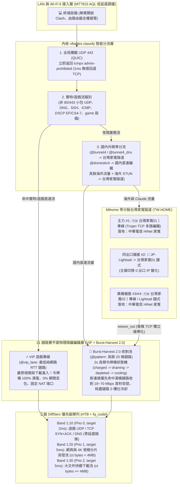
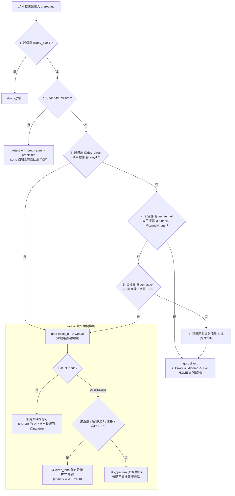

# Prism 5.0

*one beam, twenty-one wavelengths.*

運行於 Redmi AX6000（ImmortalWrt 25.12 / Linux 6.12）上的多鏈路令牌桶脈衝色散編織與零洩漏分流系統。針對上游網路按單一身份（MAC + IP）實施令牌桶限速（`CIR = 10 Mbps`, `Bc = 1.0 MB`）的場景，Prism 將單一匯聚業務流折射分散至 21 條虛擬上聯光譜通道（`wan` + `vwan1..vwan20`）：**電競與實時流獨享物理隔離的零丟包 VIP 專線，網頁、4K 視頻與下載動態收割 20 條線路的 `1.0 MB` 首秒突發窗口（`18–70 Mbps`），國內流量直連，海外與 AI 流量全閉鎖匯入單一台灣家寬出口（防封號零跳變）。**

- **完整工程與演算法設計規格書**：[DESIGN.md](DESIGN.md)
- **前端 HTTP / ubus API 規範文檔**：[API.md](API.md)
- **架構細節、詞彙表與不變量**：[prism/etc/prism/ARCHITECTURE.md](prism/etc/prism/ARCHITECTURE.md)
- **控制台面板**：<http://192.168.16.1/prism/>（局域網內狀態免登錄；修改配置使用路由器帳號登錄）

---

## 一、 系統分流與雙平面編織架構圖



### 內核數據包分流決策流程圖（縱向）



---

## 二、 核心特性

1. **`Burst-Harvest 2.0` 脈衝令牌桶收割引擎（[mod/weave.uc](prism/usr/share/prism/mod/weave.uc)）**
   - 精確建模上游網關 `CIR = 10 Mbps`、`Bc = 1.0 MB` 的單 MAC 令牌桶充放電物理過程。
   - 每條閒置滿桶線路在新連接首秒可爆發 `18–70 Mbps` 零丟包吞吐；一旦桶深耗盡（`depleted`）或速率逼近限速線，立即在 `@pattern` 中將其槽位清零（`0 slots`），強制冷卻 `2.5 秒` 回血，徹底規避上游尾丟棄（Tail-Drop）引發的 TCP 擁塞窗口塌陷。
2. **`@vip_lane` 電競與實時流物理隔離專線（[mod/weave.uc](prism/usr/share/prism/mod/weave.uc) & [mod/strands.uc](prism/usr/share/prism/mod/strands.uc)）**
   - 探針採用純網路首包延遲（`time_starttransfer - time_namelookup`）剔除本地 DNS 等待誤差，自動選出全場延遲最低且零擁塞的 1 條線路作為 `@vip_lane`，專供遊戲、語音與控制包使用，享受 `0%` 網關限速器丟包與穩定 NAT 映射；若單條流累計超過 `50 MB` 則自動驅逐回普通收割池。
3. **三級 DiffServ 優先級隊列與 TCP ACK 加速（[mod/host.uc](prism/usr/share/prism/mod/host.uc) & [tpl/prism.nft.ut](prism/usr/share/prism/tpl/prism.nft.ut)）**
   - 在 `wan` 與 `br-lan` 上部署三級 `HTB + fq_codel`（`1:10` 實時插隊隊列 `target 2ms`、`1:20` 交互突發隊列、`1:30` 大流下載隊列），確保滿載下載時遊戲包與小於 `128B` 的 TCP `SYN/ACK` 零排隊發送。
4. **`TW-HOME` 台灣家寬零跳變籠與 `inet prism_guard` 防洩漏保護（[mod/tunnel.uc](prism/usr/share/prism/mod/tunnel.uc) & [mod/guard.uc](prism/usr/share/prism/mod/guard.uc)）**
   - 自動合成 `JP-Lightsail -> 台灣家寬` 鏈式備援節點，將所有海外與 Claude/Anthropic 流量鎖定在同一個台灣中華電信家寬出口 IP，消除多地區 IP 跳變。
   - 獨立於服務生命週期的 `inet prism_guard` 表強制執行 `fail_open = 0`（Fail-Closed），即使服務停止或重啟，受保護流量與境外 DNS 也絕不會回退至直連。

---

## 三、 目錄結構

```text
API.md         前端 HTTP / ubus JSON-RPC 完整接口規範（供前端開發使用）
DESIGN.md      Prism 5.0 物理實測基線、數學模型與工程詳細設計文檔
prism/         路由器根目錄鏡像（按絕對路徑對應 /etc、/usr、/www、/lib）
tools/         本機側部署、演練與測試腳本
legacy/        早期 v1（shell）與 v2（hotel-suite）歸檔快照
```

---

## 四、 日常操作與部署命令

```sh
tools/rsh                        # 登錄路由器（密鑰 ~/.ssh/id_ed25519_ax6000）
tools/rsh prism strands          # 查看 21 條線路：健康、令牌桶狀態、純網路 TTFB、速率、槽位
tools/rsh prism doctor           # 執行全項健康與隱私保護體檢
tools/rsh prism events           # 查看最近的狀態轉換日誌

tools/rehearse.sh plan --full    # 將本地代碼同步至路由器 /tmp 演練，不改動線上狀態
tools/deploy.sh                  # 部署代碼、規則列表與頁面，體檢不過自動回滾
tools/deploy.sh --config         # 連同 /etc/config/prism 一起推送
tools/deploy.sh --assets         # 連同 mihomo.gz / 域名表 / 面板靜態資源一起推送
tools/deploy.sh --secrets        # 連同 relays.json 一起推送
```

---

## 五、 常用修改位置速查

| 調整項 | 文件路徑 |
|---|---|
| 全局參數與可調範圍白名單 | `prism/etc/config/prism`、`prism/usr/share/prism/lib/config.uc`（`SCHEMA` / `TUNABLE`） |
| 國內白名單段 / 強制隧道段 / 強制隧道域名 | `prism/etc/prism/lists/`（`domestic4.list`、`tunnel4.list`、`tunnel-domains.list`） |
| 代理中繼節點配置 | `prism/etc/prism/relays.json`（不入 Git 庫，需 `--secrets` 推送） |
| 令牌桶參數與 `Burst-Harvest 2.0` 權重 | `prism/usr/share/prism/mod/weave.uc` |
| 內核 `nftables` 骨架與分流規則 | `prism/usr/share/prism/tpl/prism.nft.ut`、`prism/usr/share/prism/mod/kernel.uc` |
| Portal 認證插件 | `prism/usr/share/prism/portal/linkbroad.uc` |
| 前端 ubus API 實現 | `prism/usr/share/prism/mod/api.uc`（規範見 [API.md](API.md)） |
| 前端模組化控制台 | `prism/www/prism/`（`index.html`、`css/`、`js/` 原生 ES6 Modules） |
