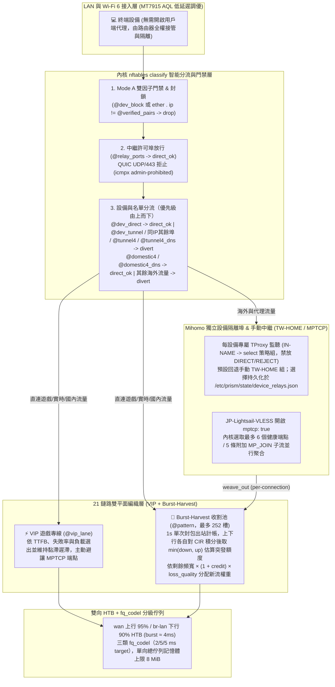

# Prism 5.9

*one beam, twenty-one wavelengths.*

運行於 Redmi AX6000（ImmortalWrt 25.12 / Linux 6.12 aarch64）上的多鏈路雙向令牌桶編織、設備隔離與零洩漏分流系統。針對上游網路按單一 L3 身份（MAC + DHCP IP）實施令牌桶限速（`CIR ≈ 10 Mbps`, `Bc = 1.0 MB`）且受限於 `100 Mbps` 實體銅線埠的場景，Prism 將業務流分散編織至 21 條上聯光譜通道（`wan` + `vwan1..vwan20`）：**電競與實時流使用物理隔離的 VIP 專線，常規直連/代理連線動態收割各健康線路突發與剩餘頻寬，Mode A `MAC . IP` 雙因子與每設備獨立 TProxy 埠確保跨設備與境外流量嚴格防洩漏，自建 `JP-Lightsail-VLESS` 節點透過最多 6 端點 / 5 附加子流 MPTCP 突破單線 10 Mbps 限制。**

- **系統架構總覽**：[ARCHITECTURE.md](ARCHITECTURE.md) · **細部設計與不變量**：[prism/etc/prism/ARCHITECTURE.md](prism/etc/prism/ARCHITECTURE.md)
- **前端 HTTP / ubus API 規範**：[API.md](API.md)
- **5.8.0 工程與驗證報告**：[ENGINEERING_REPORT.md](ENGINEERING_REPORT.md)
- **歷史設計規格（歸檔參考）**：[DEVICE_ROUTING_DESIGN.md](DEVICE_ROUTING_DESIGN.md) · [DESIGN.md](DESIGN.md)
- **控制台面板**：<http://192.168.16.1/prism/>（局域網內只讀狀態免登錄；修改配置或檢視連線流表須使用路由器帳號登錄）

---

## 一、 系統分流與雙平面編織架構



---

## 二、 現行架構重點（5.9.1）

1. **單次封包計帳與雙向獨立 Burst-Harvest（[weave.uc](prism/usr/share/prism/mod/weave.uc) & [prism.nft.ut](prism/usr/share/prism/tpl/prism.nft.ut)）**
   - `postrouting` 在單一規則 `oifname @strands_up jump acct_wan_up` 累加出站計數；每條線路上下行獨立依 `clamp(tokens + (CIR - rate) * dt, 0, 1MB)` 積分，再依剩餘容量、可用突發信用與阻尼平滑後的 HTTP 探測品質分配 `@pattern` 權重。
   - `@vip_lane`（遊戲/實時流量與 `<=1500B` VIP 封包）依 CIR 比例滯回與 90 秒最小駐留冷卻穩定鎖定低延遲非 MPTCP 線路；當健康線路 $\ge 4$ 條時從 `@pattern` 收割池排除，與在役 MPTCP 端點保持互斥。
2. **原子化防洩漏與嚴格模式 A 設備隔離（[kernel.uc](prism/usr/share/prism/mod/kernel.uc)、[guard.uc](prism/usr/share/prism/mod/guard.uc)、[identity.uc](prism/usr/share/prism/mod/identity.uc)）**
   - 強制 `fail_open = 0` 與 `remainder = "tunnel"`，主規則與 `inet prism_guard` 於單一 `nft -f` 交易同步更新，開機尚未完成第一輪協調前即由 [30-prism-guard.nft](prism/usr/share/nftables.d/ruleset-post/30-prism-guard.nft) 預設 `drop` 阻斷未授權轉發。
   - 透過 `@relay_ports`（`ipv4_addr . inet_proto . inet_service`）僅放行中繼協定與埠，若中繼 IP 與 `@domestic4` 重疊，其餘連接埠仍在 `@domestic4` 前強制轉入 `divert`。
   - DHCP 熱插拔經 [50-prism](prism/etc/hotplug.d/dhcp/50-prism) → [dhcp.uc](prism/usr/share/prism/bin/dhcp.uc) 記錄指紋並觸發協調，使 `@verified_pairs` 與 `prism_guard` 永遠同步更新，防止靜態搶佔或跨設備串線。
3. **低開銷控制面與無 Swap 記憶體調校（[facts.uc](prism/usr/share/prism/lib/facts.uc)、[prismd.uc](prism/usr/share/prism/prismd.uc)、[api.uc](prism/usr/share/prism/mod/api.uc)、[host.uc](prism/usr/share/prism/mod/host.uc)）**
   - 以原生 `rtnl` 查詢介面/鄰居/橋表，`series.uc` 使用 O(1) 環形緩衝區，24 小時 1 分鐘遙測按整分鐘邊界對齊；設備掃描、QoS 統計與 Mihomo 輪詢採用 4 秒週期與非阻塞 `uloop.process`；`connections` 透過 `uloop.task` 背景串流讀取 `/proc/net/nf_conntrack` 前 400 大流並附帶單調時間戳。
   - [99-prism.conf](prism/etc/sysctl.d/99-prism.conf)、[host.uc](prism/usr/share/prism/mod/host.uc) 與 [init.d/prism](prism/etc/init.d/prism) 針對 488 MB 無 Swap 路由器配置 socket buffer（預設 `212992`，TCP 上限 `8 MiB`）、`nf_conntrack_max`（`65536`）、Mihomo `GOMEMLIMIT=96MiB`、SmartDNS 16,384 條目快取、約 4 ms HTB burst 與單向 8 MiB（`2 MiB / 4 MiB / 2 MiB`）`fq_codel` 佇列記憶體上限。

---

## 三、 目錄結構

```text
README.md                    專案入口與維護操作手冊
ARCHITECTURE.md              根目錄架構索引
API.md                       Prism 5.8 前端 HTTP / ubus API 規範（與 rpcd ACL 對應）
ENGINEERING_REPORT.md        5.8.0 診斷實測、改動摘要與部署後驗證記錄
DESIGN.md                    5.0 原始實體測試與數學基線（歸檔參考）
DEVICE_ROUTING_DESIGN.md     多設備隔離與認證設計規格（階段性歸檔參考）
prism/                       路由器根目錄鏡像（/etc、/lib、/usr、/www）
tools/                       本地演練（rehearse.sh）、後端與隱私測試、版本檢查與部署腳本
legacy/                      早期 v1（shell）與 v2（hotel-suite）歸檔快照
```

---

## 四、 維護模式驗證與部署指令

### 1. 本機與路由器非破壞性驗證（改動後必跑）

```bash
git diff --check
./tools/version.sh --check
find prism/www/prism/js -name '*.js' -print0 | xargs -0 -n1 node --check
for f in tools/*.sh; do bash -n "$f"; done

./tools/rehearse.sh plan --full          # 將本地樹同步至 /tmp/prism-rehearsal 演練並校驗，不更動線上狀態
./tools/rsh 'sh -s' < tools/test-backend.sh
./tools/rsh 'sh -s' < tools/test-privacy-netns.sh
```

### 2. 部署與線上健康核對

```bash
./tools/deploy.sh                        # 同步代碼/清單/前端，自動校驗版本與 LF，不通過則回滾
./tools/deploy.sh --config               # 連同 /etc/config/prism 一起推送（慎用，會覆蓋面板修改）
./tools/deploy.sh --assets               # 連同 mihomo.gz / 域名表 / zashboard 靜態資源一起推送
./tools/deploy.sh --secrets              # 連同 relays.json 一起推送

./tools/rsh prism strands                # 檢查 21 條線路健康、TTFB、Burst 額度與槽位
./tools/rsh prism doctor                 # 檢查全項關鍵不變量與守護表（非 0 代表存在 fail）
./tools/rsh prism report                 # 檢視路由器資源、1H/24H 網路滾動指標與事件統計
./tools/rsh "prism events --summary"     # 依事件類別檢視近 1h / 24h / 累計狀態躍遷次數
./tools/rsh "ubus call prism status"     # 檢查運行中版本、健康數、MPTCP 子流數
./tools/rsh "logread -l 30"              # 確認無 ucode -S / OOM / nft 錯誤
```

---

## 五、 常用維護調整位置速查

| 調整項 | 文件路徑 |
|---|---|
| 全局參數與可調範圍白名單 | `prism/etc/config/prism`、`prism/usr/share/prism/lib/config.uc`（`SCHEMA` / `TUNABLE`） |
| 國內白名單段 / 強制隧道段 / 強制隧道域名 | `prism/etc/prism/lists/`（`domestic4.list`、`tunnel4.list`、`tunnel-domains.list`） |
| 代理中繼節點配置 | `prism/etc/prism/relays.json`（不入 Git 庫，需 `--secrets` 推送） |
| 令牌桶參數與 `Burst-Harvest` 權重 | `prism/usr/share/prism/mod/weave.uc` |
| 內核 `nftables` 骨架與防護規則 | `prism/usr/share/prism/tpl/prism.nft.ut`、`prism/usr/share/prism/mod/kernel.uc`、`prism/usr/share/prism/mod/guard.uc` |
| 設備指紋認證與 Mode A 准入 | `prism/usr/share/prism/mod/identity.uc`、`prism/usr/share/prism/bin/dhcp.uc` |
| Portal 認證插件 | `prism/usr/share/prism/portal/linkbroad.uc` |
| 前端 `ubus` API 與權限清單 | `prism/usr/share/prism/mod/api.uc`、`prism/usr/share/rpcd/acl.d/prism.json`（規範見 [API.md](API.md)） |
| 前端模組化控制台 | `prism/www/prism/`（`index.html`、`css/`、`js/` 原生 ES6 Modules） |
| 若更新版號需同步前/後端 | `./tools/version.sh <新版本>`（修改完用 `./tools/version.sh --check` 確認一致性） |
