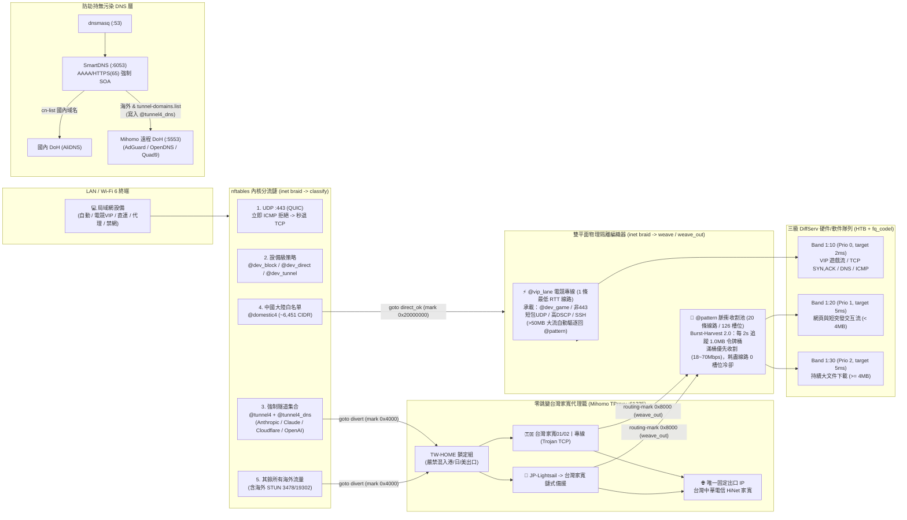

# Braid 5.0

*many strands, one line.*

運行於 Redmi AX6000（ImmortalWrt 25.12 / Linux 6.12）上的多鏈路令牌桶脈衝編織與零洩漏分流系統。針對上游網路按單一身份（MAC + IP）實施令牌桶限速（`CIR = 10 Mbps`, `Bc = 1.0 MB`）的場景，Braid 將 21 條虛擬上聯身份（`wan` + `vwan1..vwan20`）編織為單一邏輯寬頻：**電競與實時流獨享物理隔離的零丟包 VIP 專線，網頁、4K 視頻與下載動態收割 20 條線路的 `1.0 MB` 首秒突發窗口（`18–70 Mbps`），國內流量直連，海外與 AI 流量全閉鎖匯入單一台灣家寬出口（防封號零跳變）。**

- **完整工程與演算法設計規格書**：[DESIGN.md](DESIGN.md)
- **前端 HTTP / ubus API 規範文檔**：[API.md](API.md)
- **架構細節、詞彙表與不變量**：[braid/etc/braid/ARCHITECTURE.md](braid/etc/braid/ARCHITECTURE.md)
- **控制台面板**：<http://192.168.16.1/braid/>（局域網內狀態免登錄；修改配置使用路由器帳號登錄）

---

## 一、 全景分流與系統架構圖

### 1.1 端到端流量分類、雙平面編織與台灣家寬防封號拓撲（Mermaid）



### 1.2 內核數據包路徑與雙進程協同圖（ASCII）

```text
            慢、會失敗、可重試 (每 60s / 事件觸發)          快、常駐記憶體、每 2s 閉環
   ┌──────────────────────────────────────────┐      ┌──────────────────────────────────────────┐
   │ braid reconcile  (一次性調諧進程)          │      │ braidd  (常駐守護進程)                    │
   │  0. 憑網關 MAC 識別站點 -> 拉起 vwan1..20 │◀─拉起─│  • 每 2s 讀取 @strands / @strands_up 計數│
   │  1. 建立策略路由表 1001..1021 與 ip rule  │      │  • 計算 21 條線路 1.0MB 虛擬令牌桶充放電 │
   │  2. 並行 HTTP 204 探測 -> Portal 自動認證│─快照─▶│  • 動態鎖定最低純網路 RTT 線路至 @vip_lane│
   │  3. 渲染校驗 Mihomo / SmartDNS / Guard   │      │  • 重排 126 槽位 @pattern (耗盡線路歸零) │
   │  4. 原子更新 nftables + 全項 Doctor 體檢 │      │  • 透過 ubus 發布實時遙測與管理 API       │
   └──────────────────────────────────────────┘      └──────────────────────────────────────────┘

LAN 數據包進入 br-lan
 │
 ├─► dns_hijack (nat prerouting) ────► TCP/UDP 53 重定向至本機 dnsmasq -> SmartDNS (:6053)
 │
 ▼
prerouting (mangle)
 ├─► jump classify (順序即優先級，每條規則帶實時命中有計數器)
 │     ├─ @dev_block                  ──► drop (設備禁網)
 │     ├─ udp dport 443               ──► reject (攔截 QUIC，強制瀏覽器 1ms 回退 TCP 多路並發)
 │     ├─ @dev_direct / @relay4       ──► goto direct_ok (顯式直連設備、代理入口 IP 不套娃)
 │     ├─ @dev_tunnel                 ──► goto divert (顯式全局代理設備)
 │     ├─ @tunnel4 / @tunnel4_dns     ──► goto divert (Anthropic/Claude/Cloudflare 強制進隧道)
 │     ├─ @domestic4                  ──► goto direct_ok (中國大陸 IP 直連，不經過 Mihomo)
 │     ├─ udp dport {3478,5349,19302} ──► goto divert (海外 WebRTC STUN 強制進隧道防漏 IP)
 │     └─ remainder                   ──► goto divert (其餘海外流量全部進隧道)
 │
 ├─► chain divert
 │     └─ TProxy 轉交 198.51.100.1:61235 (Mihomo) ──► 出站包帶 0x8000 標記 ──► output -> weave_out
 │
 └─► chain direct_ok
       ├─ jump weave
       │    ├─ 存量連接已超 50MB 的 VIP 流 ──► 自動剝離 0x100 標記，遷回 @pattern 普通收割池
       │    ├─ 存量連接 (ct mark & 0xff)  ──► 保持原線路不變 (零斷流)
       │    ├─ 新建遊戲/UDP短包/SSH/高DSCP ──► 查 @vip_lane 綁定最低延遲專線 (ct mark = id | 0x100)
       │    └─ 新建常規 TCP/UDP 連接       ──► 查 @pattern (126 槽位 SWRR) 收割滿桶脈衝線路
       └─ 寫入單包授權位 0x20000000 ──► 通過獨立表 inet braid_guard 放行校驗 ──► postrouting 三級 HTB 隊列
```

---

## 二、 核心特性

1. **`Burst-Harvest 2.0` 脈衝令牌桶收割引擎（[mod/weave.uc](braid/usr/share/braid/mod/weave.uc)）**
   - 精確建模上游網關 `CIR = 10 Mbps`、`Bc = 1.0 MB` 的單 MAC 令牌桶充放電物理過程。
   - 每條閒置滿桶線路在新連接首秒可爆發 `18–70 Mbps` 零丟包吞吐；一旦桶深耗盡（`depleted`）或速率逼近限速線，立即在 `@pattern` 中將其槽位清零（`0 slots`），強制冷卻 `2.5 秒` 回血，徹底規避上游尾丟棄（Tail-Drop）引發的 TCP 擁塞窗口塌陷。
2. **`@vip_lane` 電競與實時流物理隔離專線（[mod/weave.uc](braid/usr/share/braid/mod/weave.uc) & [mod/strands.uc](braid/usr/share/braid/mod/strands.uc)）**
   - 探針採用純網路首包延遲（`time_starttransfer - time_namelookup`）剔除本地 DNS 等待誤差，自動選出全場延遲最低且零擁塞的 1 條線路作為 `@vip_lane`，專供遊戲、語音與控制包使用，享受 `0%` 網關限速器丟包與穩定 NAT 映射。
3. **三級 DiffServ 優先級隊列與 TCP ACK 加速（[mod/host.uc](braid/usr/share/braid/mod/host.uc) & [tpl/braid.nft.ut](braid/usr/share/braid/tpl/braid.nft.ut)）**
   - 在 `wan` 與 `br-lan` 上部署三級 `HTB + fq_codel`（`1:10` 實時插隊隊列 `target 2ms`、`1:20` 交互突發隊列、`1:30` 大流下載隊列），確保滿載下載時遊戲包與小於 `128B` 的 TCP `SYN/ACK` 零排隊發送。
4. **`TW-HOME` 台灣家寬零跳變籠與 `inet braid_guard` 防洩漏保護（[mod/tunnel.uc](braid/usr/share/braid/mod/tunnel.uc) & [mod/guard.uc](braid/usr/share/braid/mod/guard.uc)）**
   - 自動合成 `JP-Lightsail -> 台灣家寬` 鏈式備援節點，將所有海外與 Claude/Anthropic 流量鎖定在同一個台灣中華電信家寬出口 IP，消除多地區 IP 跳變。
   - 獨立於服務生命週期的 `inet braid_guard` 表強制執行 `fail_open = 0`（Fail-Closed），即使服務停止或重啟，受保護流量與境外 DNS 也絕不會回退至直連。

---

## 三、 目錄結構

```text
API.md         前端 HTTP / ubus JSON-RPC 完整接口規範（供前端開發使用）
DESIGN.md      Braid 5.0 物理實測基線、數學模型與工程詳細設計文檔
braid/         路由器根目錄鏡像（按絕對路徑對應 /etc、/usr、/www、/lib）
tools/         本機側部署、演練與測試腳本
legacy/        早期 v1（shell）與 v2（hotel-suite）歸檔快照
```

---

## 四、 日常操作與部署命令

```sh
tools/rsh                        # 登錄路由器（密鑰 ~/.ssh/id_ed25519_ax6000）
tools/rsh braid strands          # 查看 21 條線路：健康、令牌桶狀態、純網路 TTFB、速率、槽位
tools/rsh braid doctor           # 執行全項健康與隱私保護體檢
tools/rsh braid events           # 查看最近的狀態轉換日誌

tools/rehearse.sh plan --full    # 將本地代碼同步至路由器 /tmp 演練，不改動線上狀態
tools/deploy.sh                  # 部署代碼、規則列表與頁面，體檢不過自動回滾
tools/deploy.sh --config         # 連同 /etc/config/braid 一起推送
tools/deploy.sh --assets         # 連同 mihomo.gz / 域名表 / 面板靜態資源一起推送
tools/deploy.sh --secrets        # 連同 relays.json 一起推送
```

---

## 五、 常用修改位置速查

| 調整項 | 文件路徑 |
|---|---|
| 全局參數與可調範圍白名單 | `braid/etc/config/braid`、`braid/usr/share/braid/lib/config.uc`（`SCHEMA` / `TUNABLE`） |
| 國內白名單段 / 強制隧道段 / 強制隧道域名 | `braid/etc/braid/lists/`（`domestic4.list`、`tunnel4.list`、`tunnel-domains.list`） |
| 代理中繼節點配置 | `braid/etc/braid/relays.json`（不入 Git 庫，需 `--secrets` 推送） |
| 令牌桶參數与 `Burst-Harvest 2.0` 權重 | `braid/usr/share/braid/mod/weave.uc` |
| 內核 `nftables` 骨架与分流規則 | `braid/usr/share/braid/tpl/braid.nft.ut`、`braid/usr/share/braid/mod/kernel.uc` |
| Portal 認證插件 | `braid/usr/share/braid/portal/linkbroad.uc` |
| 前端 ubus API 實現 | `braid/usr/share/braid/mod/api.uc`（規範見 [API.md](API.md)） |
| 前端單頁控制台 | `braid/www/braid/index.html` |
